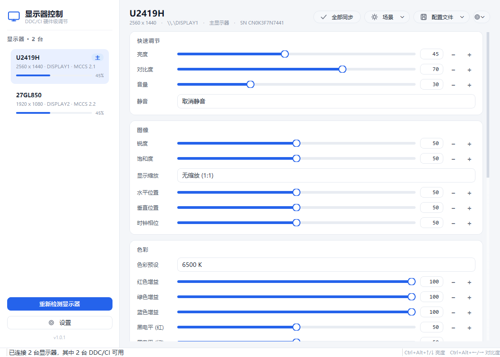
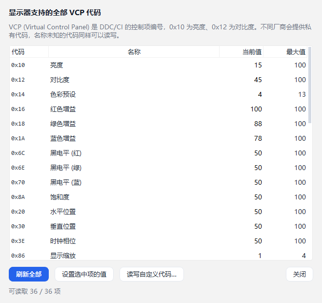
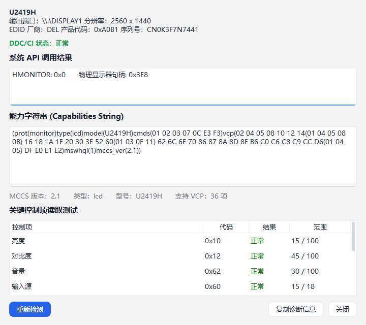
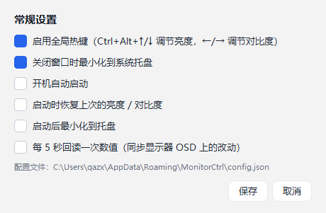

# MonitorCtrl · Windows 显示器硬件控制

通过 **DDC/CI** 协议直接与显示器通信，调节**硬件级**亮度、对比度、音量、输入源、色彩增益等参数。
不依赖显卡驱动、不需要厂商工具，对所有支持 DDC/CI 的显示器通用。



## 功能

**核心控制**

- 亮度、对比度、音量、静音、锐度、饱和度、色相
- 输入源切换（HDMI / DP / USB-C / VGA …，按显示器实际支持项生成）
- 色彩预设（sRGB、6500K、9300K、用户模式…）与 R/G/B 三通道增益、黑电平
- 电源模式、显示缩放、几何校正（老显示器 / 投影仪）
- 恢复出厂设置

**自动化与效率**

- **全部同步**：亮度 / 对比度按比例同步到所有显示器
- **场景预设**：阅读、办公、游戏、影院、夜间，一键切换亮度+对比度+色温
- **配置文件**：保存整套设置（按显示器型号+序列号匹配），随时恢复
- **全局热键**：`Ctrl+Alt+↑/↓` 调亮度，`Ctrl+Alt+←/→` 调对比度（任意程序中可用）
- **系统托盘**：最小化到托盘，托盘菜单快速调亮度、切场景
- **开机自启** / 启动时恢复上次亮度

**高级**

- **VCP 浏览器**：列出显示器上报的全部 VCP 代码，直接读写任意代码（含厂商私有代码）
- **显示器诊断**：能力字符串原文、MCCS 版本、逐项读取测试、一键复制诊断报告
- **命令行模式**：可被脚本 / 计划任务 / Stream Deck 等外部程序调用

## 界面

**VCP 浏览器** — 列出显示器上报的全部控制项，可直接读写任意代码（含厂商私有项）



**显示器诊断** — 能力字符串原文、MCCS 版本、关键控制项逐项测试



**设置** — 全局热键、托盘、开机自启、定期回读



## 运行

### 方式一：可执行文件（推荐）

双击 `dist/MonitorCtrl.exe` 即可，无需安装 Python。

### 方式二：源码运行

```bash
pip install -r requirements.txt
python main.py
```

要求 Windows 10/11 + Python 3.10+。

## 命令行用法

```bash
MonitorCtrl.exe --list                  # 列出显示器（含 DDC/CI 状态、亮度）
MonitorCtrl.exe -b 60                   # 主显示器亮度设为 60%
MonitorCtrl.exe -b 40 -a                # 所有显示器亮度设为 40%
MonitorCtrl.exe -c 70 -m 1              # 第 1 号显示器对比度设为 70%
MonitorCtrl.exe --volume 30             # 音量 30%
MonitorCtrl.exe --input 17              # 切换到 HDMI 1
MonitorCtrl.exe --get 0x10              # 读取 VCP 0x10 当前值/最大值
MonitorCtrl.exe --set 0x62=50           # 直接写任意 VCP
MonitorCtrl.exe --list --json           # JSON 输出，便于脚本处理
MonitorCtrl.exe --minimized             # 启动后直接进托盘
```

退出码：`0` 成功，`2` 无可用显示器，`3` 写入失败。

## 操作提示

- **滚轮只滚动页面，不会误改数值**。想在滑杆上用滚轮微调，按住 `Ctrl` 再滚。
- 下拉框（输入源、色彩预设等）同样不会被滚轮误切，点开再选。
- 滑杆右侧可以直接输入数字，`+ / −` 按钮每次步进 1%。

## 全局热键

| 快捷键 | 作用 |
| --- | --- |
| `Ctrl+Alt+↑` / `Ctrl+Alt+↓` | 当前显示器亮度 ±5% |
| `Ctrl+Alt+←` / `Ctrl+Alt+→` | 当前显示器对比度 ∓5% |

热键被占用时，状态栏会提示；可在「设置」中关闭。

## 配置文件

所有设置保存在 `%APPDATA%\MonitorCtrl\config.json`：

- `profiles`：保存的配置文件（含每台显示器的 VCP 值与名称标签）
- `last_state`：上次退出时的亮度/对比度
- `settings`：热键、托盘、开机自启等开关

删除该文件即可恢复默认。

## 常见问题

**「DDC/CI 不可用」/ 读不到亮度**

先跑一次深度诊断，把结果发出来就能定位卡在哪一步：

```bash
MonitorCtrl.exe --diag
```

输出会显示每次 API 调用的返回值、错误码、句柄、EDID 与能力字符串，例如：

```
尝试1: 数量=1 (ok=True,err=0)  获取=成功 (ok=True,err=0)  句柄=['0x0']
尝试2: 数量=1 (ok=True,err=0)  获取=成功 (ok=True,err=0)  句柄=['0x1']
```

- 句柄为 `0x0`：驱动这次没给出 DDC 通道，程序会自动重试 3 次（很多驱动第一次枚举会返回空）
- 三次都是 `0x0`：该输出没有可用的 DDC 通道，通常是驱动 / 转接器 / 显示器 EDID 异常
- 有句柄但读 VCP 报错：错误码会直接翻译成原因（31 无响应、50 不支持…）

再按顺序排查：

1. 显示器 OSD 菜单里打开 **DDC/CI**（Dell 叫 DDC/CI，LG 叫 DDC/CI，AOC 叫 DDC/CI，部分品牌在「其他设置」里）。注意有些显示器是**按输入接口分别设置**的，切换过 HDMI/DP 后要重新确认。
2. 使用 **HDMI / DisplayPort 直连**。部分 USB-C 扩展坞、KVM、HDMI 转接器、采集卡会屏蔽 DDC 通道。
3. 笔记本内置屏幕通常不支持 DDC/CI；虚拟机（VMware / VirtualBox / RDP）也没有真实 DDC 通道。
4. 部分显示器需要关闭「节能模式」或「DisplayPort 1.2 深度休眠」。
5. 用「显示器诊断」查看能力字符串：能读到字符串说明 DDC 通，但具体 VCP 不支持则无法控制该项。

**亮度调了没反应**

部分显示器对写入频率敏感，程序已做 70ms 防抖与失败重试；如果仍无反应，试着先读一次再写（VCP 浏览器里的「刷新全部」），或在 OSD 里关闭「自动亮度」。

**能调亮度但调不了音量**

音量（0x62）需要显示器带扬声器并在 OSD 中启用；不带扬声器的显示器通常不实现该 VCP。

## 更新记录

**v1.0.3**

- 改为窗口化程序：启动时不再出现黑色控制台窗口（Windows 11 的 Windows Terminal 无法被程序隐藏）
- 命令行模式改为按需接管父控制台，重定向输出仍然可用
- 修复 `QFont::setPointSize: Point size <= 0 (-1)` 警告

**v1.0.2**

- 修复滚动页面时鼠标滚轮误改滑杆 / 下拉框的问题：滚轮默认只滚动页面，按住 Ctrl 才微调数值
- 滑杆提示文字补充了 Ctrl+滚轮 的说明

**v1.0.1**

- 修复部分显卡驱动首次枚举返回空句柄导致误判「DDC/CI 不可用」：现在会重试 3 次
- 显示器不返回能力字符串时，自动试读标准 VCP，界面不再只有亮度/对比度
- 新增 `--diag` 深度诊断，输出每次 API 调用结果、错误码、句柄、EDID
- 错误码翻译成可读原因（31 无响应、50 不支持、121 超时…）
- 无 DDC 时界面提供「运行深度诊断」「复制诊断报告」入口

## 技术实现

| 模块 | 说明 |
| --- | --- |
| `monitorctl/ddc.py` | 基于 `dxva2.dll` 的 `GetPhysicalMonitorsFromHMONITOR` / `GetVCPFeatureAndVCPFeatureReply` / `SetVCPFeature` / `CapabilitiesRequestAndCapabilitiesReply`，用 `ctypes` 直接调用；注册表 EDID 解析厂商、型号、序列号 |
| `monitorctl/vcp.py` | VCP 代码表（MCCS）、能力字符串递归下降解析器、场景预设 |
| `monitorctl/controller.py` | 单线程串行化 DDC 队列：写操作优先、同目标写入合并防抖，回调回主线程 |
| `monitorctl/main_window.py` | 主界面：按能力字符串动态生成控件、同步、场景、配置文件、热键、托盘 |
| `monitorctl/ui/` | 主题样式表、自绘图标、滑杆 / 卡片等控件、对话框 |

DDC/CI 是单次 30–150ms 的低速串行协议，程序把所有调用放到一个后台线程串行执行，
拖动滑杆时只保留最后一次值，避免阻塞界面和把显示器写崩。

## 目录结构

```
MonitorCtrl/
├─ main.py                 入口（GUI + CLI）
├─ build.py                打包脚本
├─ requirements.txt
├─ assets/icon.ico         应用图标
├─ monitorctl/
│  ├─ ddc.py               DDC/CI 底层
│  ├─ vcp.py               VCP 表 + 能力字符串解析
│  ├─ controller.py        后台串行队列
│  ├─ config.py            配置持久化
│  ├─ main_window.py       主窗口
│  └─ ui/                  主题、控件、对话框
└─ tools/
   ├─ preview.py           模拟显示器预览界面（无硬件也能看 UI）
   ├─ smoke_test.py        功能自检
   └─ make_icon.py         生成图标
```

## 开发

```bash
python tools/preview.py      # 用两台模拟显示器渲染界面截图
python tools/smoke_test.py   # 功能自检（滑杆写入、同步、场景、对话框）
python build.py              # 打包单文件 exe
```

> 模拟预览不会触碰真实硬件，可安全用于调试界面。
